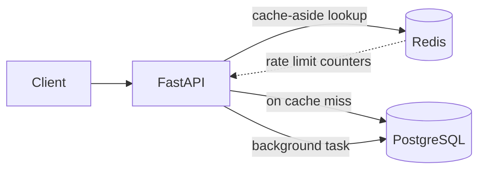

# URL Shortener API


A FastAPI URL shortener with JWT auth, Redis caching, rate limiting, and click analytics.

## Architecture



**Redirect flow:** check Redis → on a miss, query Postgres and populate Redis (1h TTL) → return a 307 redirect → log the click in a background task.

## Features
- JWT authentication (bcrypt-hashed passwords)
- Short links with optional custom alias
- Redis cache-aside on the redirect path
- Per-IP fixed-window rate limiting (429 + `Retry-After`)
- Click analytics (hashed IP, user agent) logged off the request path
- Alembic migrations, pytest suite, CI

## Quick start

```bash
git clone https://github.com/USER/REPO.git
cd REPO
cp .env.example .env      # then edit the secrets
docker compose up --build
```

API docs (Swagger): http://localhost:8000/docs

## Running tests

```bash
pip install -r requirements.txt
pytest -v
```

Tests use in-memory SQLite and fakeredis, so no services are needed.

## Design decisions
- **Cache-aside, not pre-warming:** the cache fills from real traffic. A TTL bounds staleness, and the cache entry is deleted on update/delete.
- **307, not 301:** browsers cache 301s, which would hide repeat clicks from analytics.
- **Background click logging:** the redirect doesn't wait on a DB write. The tradeoff is that stats are eventually consistent.
- **Redis is an optimization, not a dependency:** the cache and rate limiter fail open, so a Redis outage costs speed, not availability.

## What I'd add next
- Sliding-window or token-bucket rate limiting (fixed windows allow bursts at window edges)
- Celery/RQ with a message broker for analytics, replacing in-process background tasks
- Fully async stack (`asyncpg`, `redis.asyncio`) for higher concurrency
- Horizontal scaling: multiple API instances behind a load balancer (Redis already holds the shared state), plus Postgres read replicas
- Link expiry, negative caching for unknown codes, QR codes